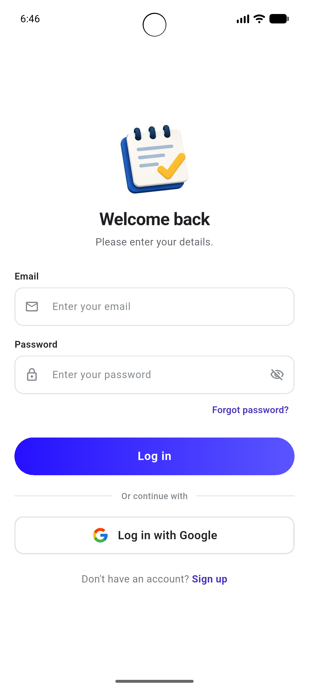
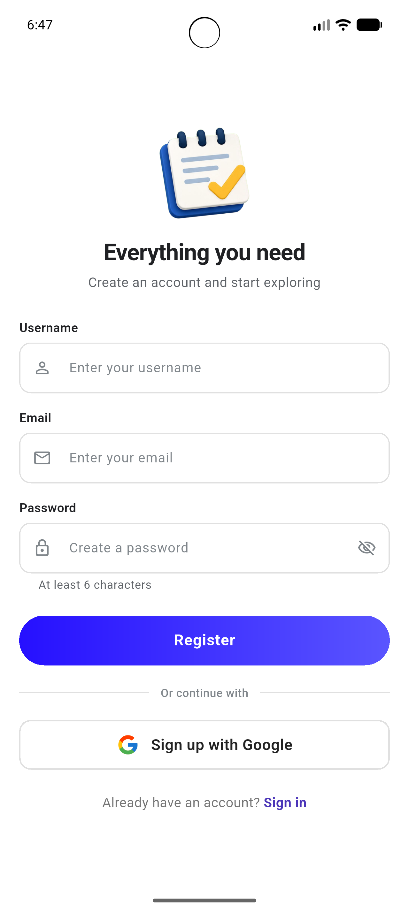
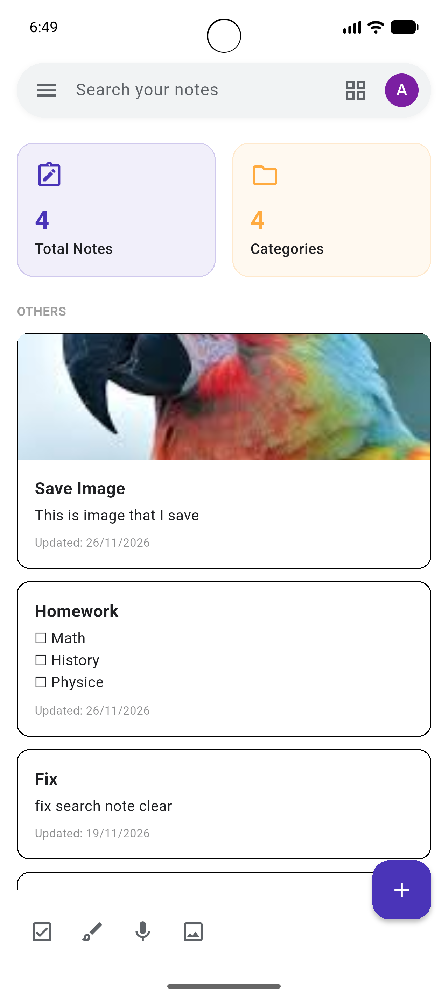
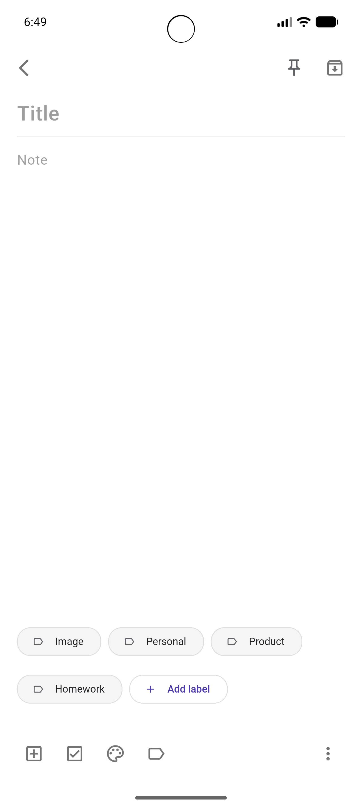

# Kot Tok

**Kot Tok** (*"Notes and lists"*) is a cross-platform Flutter note-taking and checklist application inspired by clean, card-based productivity workflows and powered by **Supabase**.

---

## Features

- **Authentication & Session Management**
  - Splash screen with automatic session check (`SplashScreen` → `MainNavigationScreen` or `SignInScreen`).
  - Email/password sign-in, account registration, and password reset (`SignInScreen`, `SignUpScreen`, `ForgetPasswordScreen`).
  - Automatic `profiles` record synchronization on sign-in/sign-up.
- **Notes Dashboard**
  - Summary statistics card showing total notes and label counts (`SummaryStatsCard`).
  - Dedicated **Pinned** and **Recent** notes sections with pull-to-refresh.
  - Real-time client-side search across note titles and contents (`SearchAppBar`).
  - Toggle between single-column list and grid layouts (`BottomAppBarProvider`).
- **Note & Checklist Editor**
  - Create, edit, pin/unpin, and delete notes with auto-save on back navigation (`NoteEditorScreen`).
  - Interactive **Checklist mode** (`☐` / `☑`) with completion progress tracking and collapsible checked items.
  - **Multi-image attachments** selected from gallery (`image_picker`) and uploaded to Supabase Storage.
  - Assign or create labels directly within the editor.
- **Labels / Categories**
  - Create, edit, delete, and filter notes by custom labels from the navigation drawer (`DrawerApp`, `ManageLabelsDialog`).
- **Profile Management**
  - Account dialog displaying user name, email, avatar, and sign-out action (`ProfileProvider`).

---

## Screenshots

| Sign In | Sign Up | Home | Note Editor |
| :---: | :---: | :---: | :---: |
|  |  |  |  |

---

## Tech Stack

| Layer | Technology |
| --- | --- |
| **Framework** | Flutter (Material 3, Dart SDK `^3.12.2`) |
| **State Management** | `provider` (`^6.1.5+1`) |
| **Backend & Auth** | `supabase_flutter` (`^2.18.3`) |
| **Media Picker** | `image_picker` (`^1.2.4`) |
| **Logging** | `logger` (`^2.8.0`) |
| **Testing & Linting** | `flutter_test`, `shared_preferences`, `flutter_lints` (`^6.0.0`) |
| **Typography** | Roboto Flex (`assets/fonts/RobotoFlex-Regular.ttf`) |

---

## Project Structure

```text
kot_tok/
├── android/                        # Android native configuration (Kotlin / Gradle KTS)
├── ios/                            # iOS native configuration
├── web/                            # Web entrypoint & PWA manifest
├── linux/ macos/ windows/          # Desktop platform runners
├── assets/
│   ├── fonts/                      # Roboto Flex font family
│   └── images/
│       ├── logo/                   # App logo and branding assets
│       └── screen/                 # App UI screenshots used in README
├── lib/
│   ├── main.dart                   # App entrypoint & Supabase initialization
│   ├── app/
│   │   ├── app.dart                # Root MaterialApp & MultiProvider setup
│   │   ├── routes.dart             # Named route registry (AppRoutes)
│   │   └── theme/                  # Color tokens, typography, Material 3 ThemeData
│   ├── core/
│   │   ├── constants/              # App branding & logo widgets
│   │   └── services/               # Shared Supabase client wrapper
│   └── features/
│       ├── Navigation/             # Main shell, SearchAppBar, CustomBottomAppBar
│       ├── auth/                   # Auth models, providers, services, screens, widgets
│       ├── home/                   # Notes/categories models, providers, services, screens, dialogs
│       └── splash/                 # Startup splash screen & auth redirect
├── test/
│   ├── models/user_model_test.dart # Unit tests for UserModel serialization
│   └── widget_test.dart            # Widget & smoke tests
└── pubspec.yaml                    # Dependencies & asset configuration
```

---

## Getting Started

### Prerequisites

- [Flutter SDK](https://docs.flutter.dev/get-started/install) (with Dart `^3.12.2`)
- Android Studio / VS Code with Flutter & Dart plugins
- An Android/iOS emulator, connected mobile device, desktop target, or Chrome for web

### 1. Install Dependencies

```bash
flutter pub get
```

### 2. Configure Supabase

Supabase is initialized in `lib/main.dart`. To point the app at your own Supabase project, update the `url` and `publishableKey` values in `lib/main.dart`:

```dart
await Supabase.initialize(
  url: 'YOUR_SUPABASE_URL',
  publishableKey: 'YOUR_SUPABASE_PUBLISHABLE_KEY',
);
```

#### Expected Supabase Schema & Storage

Ensure your Supabase project contains the following tables (with Row Level Security scoped to `auth.uid()`) and storage bucket:

- **`profiles`**: `id` (`uuid`, PK), `full_name` (`text`), `avatar_url` (`text`, optional)
- **`categories`**: `id` (`uuid`, PK), `user_id` (`uuid`), `name` (`text`), `created_at` (`timestamptz`)
- **`notes`**: `id` (`uuid`, PK), `user_id` (`uuid`), `category_id` (`uuid`, nullable), `title` (`text`), `content` (`text`), `image_urls` (`text[]` / `jsonb`), `is_pinned` (`bool`), `is_favorite` (`bool`), `created_at` (`timestamptz`), `updated_at` (`timestamptz`)
- **Storage Bucket**: `image_input` (stores uploaded note images under `<user_id>/<timestamp>_<filename>`)

### 3. Run the App

```bash
flutter run
```

---

## Testing & Code Quality

Run static analysis and the test suite:

```bash
flutter analyze
flutter test
```
